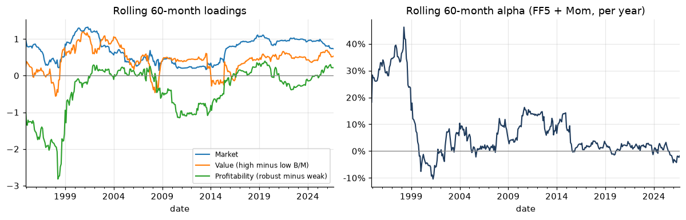
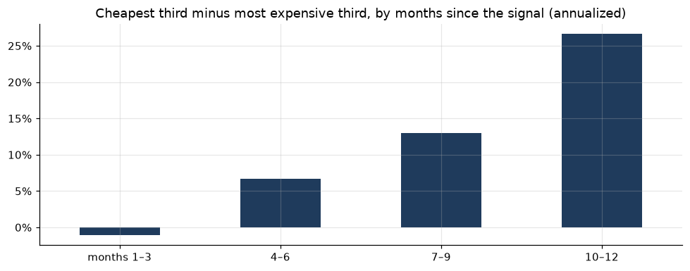
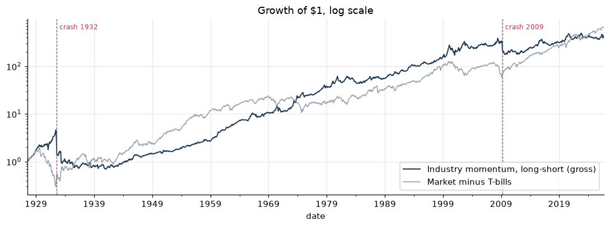
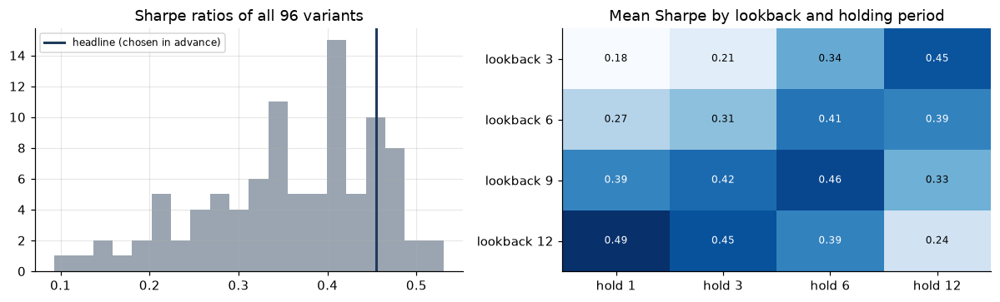
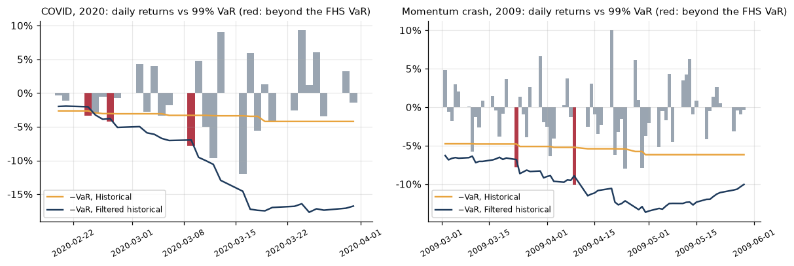
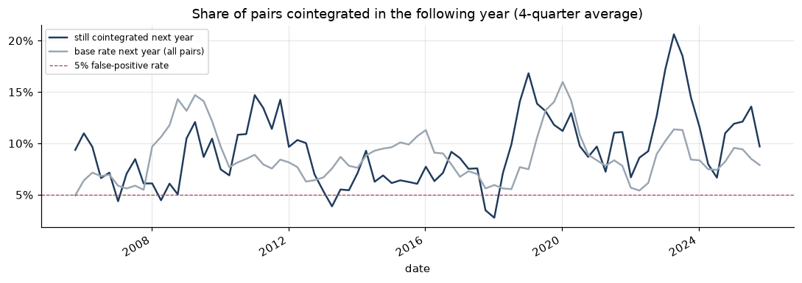
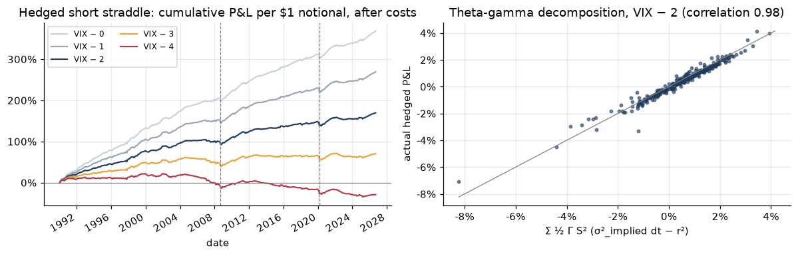

# Quant Research

**Five quantitative research studies on the questions asset managers and bank risk teams work on: factor exposure, strategy evaluation, risk models, statistical arbitrage and derivatives.**

Each study asks one question and checks its method against a known published result before applying it. It reports what the data doesn't support as plainly as what it does. All code is tested (70 tests), and every study is an executed notebook whose numbers and charts render on GitHub.

By Ran Abrahami, Business & Data Analytics student. Companion project: the [SaaS Valuation Engine](https://github.com/ranabrahami/saas-valuation-engine), an equity research report generator whose valuation signal is tested in studies 01 and 02.

## Findings

| # | Study | Question | Finding |
|---|---|---|---|
| 01 | [Factor model](notebooks/01_factor_model.ipynb) | Is a track record alpha, or factor exposure? | Berkshire's alpha is mostly value, quality and low beta, as the literature finds. My engine's valuation signal is not a disguised factor bet, but its alpha isn't significant over 3.5 years |
| 02 | [Backtester: industry momentum](notebooks/02_backtester.ipynb) | Does a published anomaly survive factors, publication, costs and crashes? | Sharpe 0.46 over 99 years. Controlling for stock momentum cuts its alpha from 10% to 1.7% a year, its Sharpe fell from 0.75 to 0.33 after publication, and its worst month was −58% |
| 03 | [Risk: VaR and Monte Carlo](notebooks/03_risk_var.ipynb) | Which VaR models keep their promise over 90 years? | Filtered historical simulation is best (1.2% exceptions, no red Basel years). Monte Carlo GARCH-t fails at 10 days until the estimated mean is set to zero |
| 04 | [Pairs trading](notebooks/04_pairs_trading.ipynb) | Does cointegration hold out of sample? | No. Pairs cointegrated this year are cointegrated next year no more often than random pairs (9%). The stock profits come from 2008–09 |
| 05 | [Options](notebooks/05_options.ipynb) | What does the market charge for volatility and crash insurance? | Crash puts cost up to 4.7x their historical payout. Variance swaps earned a real premium (Sharpe 0.8–1.2 net), but "sell straddles at VIX" backtests mostly reflect the VIX-to-ATM gap |

**One thread runs through all five: the same few crisis months.** Momentum crashed in the rebounds of 1932 and 2009. Pairs trading earned most of its 22-year profit in 2008–09. Selling volatility lost 5–10% of notional in a single month in September 2008 and March 2020. The risk models missed most in the calm periods just before these shocks. A portfolio combining these strategies is a bet on how markets behave in a handful of months.

## How the studies are built

- **Check the method on a known answer first:**
  - Berkshire's loadings against *Buffett's Alpha*;
  - Black-Scholes against Hull's textbook example;
  - industry momentum against Moskowitz and Grinblatt;
  - pairs trading following Gatev, Goetzmann and Rouwenhorst.
- **No look-ahead.** Signals are rebuilt from data available at the time, forecasts use past data only, and tests check this.
- **Designs fixed before running.** Variants tried afterwards are counted and deflated: the deflated Sharpe ratio in study 02.
- **Survivorship-free data where possible:** French's industry and market data back to 1926. Where it isn't (Yahoo stocks), the bias is shown concretely: Silicon Valley Bank and First Republic are missing.
- **Robustness built in.** Subperiods and post-publication samples, trading and borrow costs, leave-one-out, calendar-alignment checks, and block-bootstrap intervals.

## What I got wrong and fixed

Finding these is part of the work, so each is documented in its notebook:
- **A price-cache bug** silently truncated histories (study 04). I fixed it, added a regression test, and re-ran the earlier notebooks: the outputs were unchanged.
- **A look-ahead in a first draft.** It required stocks to have prices for the whole *future* trading window, which is survivorship in miniature.
- **Pairs legs sized $1/$1** mismatched the cointegration spread, so 9% of "converged" trades lost money. Sizing the legs by the hedge ratio fixed it, and the conclusions held.
- **A hedged-straddle backtest** priced at VIX showed a Sharpe of 2.8. VIX is not the at-the-money vol a seller receives, and the break-even sits about 3.7 points lower.
- **A 2-point put/call implied-vol gap**, caused by the rate and dividend inputs. Fixed by backing out the forward from put-call parity.
- **My own misreadings:** a misread Expected Shortfall statistic, and an unexpected test failure that turned out to be the central limit theorem, not a bug.

## Methods and tools

- **Models:** factor regressions with Newey-West errors, event-time and overlapping-cohort portfolios.
- **Backtesting:** drift-aware turnover, transaction and borrow costs, deflated and probabilistic Sharpe, block bootstrap.
- **Risk:** VaR and Expected Shortfall (normal, historical, EWMA, filtered historical, GARCH-t), Kupiec, Christoffersen and Basel backtests, Monte Carlo.
- **Statistical arbitrage:** Engle-Granger cointegration.
- **Derivatives:** Black-Scholes and Greeks, implied volatility, delta-hedging simulation.
- **Stack:** Python, pandas, NumPy, SciPy, statsmodels, arch, matplotlib, pytest, Jupyter.

*Educational project, not investment advice.*

---

## 01 · Factor model

Regresses monthly excess returns on the Fama-French five factors plus momentum, with Newey-West standard errors.

### Part A: Berkshire Hathaway, 1990–2026 (441 months)

| | Market | Size | Value | Profitability | Alpha / yr |
|---|---|---|---|---|---|
| Loading | 0.73 | −0.36 | +0.52 | +0.24 | +3.6% |
| t (Newey-West) | 9.6 | −3.5 | 4.7 | 2.9 | 1.4 |

- **The tool reproduces the published result.** Berkshire is a low-beta, large-cap, value-and-quality portfolio, as *Buffett's Alpha* (Frazzini, Kabiller and Pedersen) found.
- **The factors absorb the alpha.** It is significant under CAPM (6.0%, t 2.1) but not after the factors are added (3.6%, t 1.4).
- **The alpha has decayed.** It fell from 30%+ a year in the late 1990s (rolling 5-year windows) to about zero over the last decade.



### Part B: does the engine's valuation signal earn alpha? (2023–26)

Each quarter from March 2023 the portfolio goes long the six companies the engine ranked cheapest for their growth and short the six most expensive. The signals are rebuilt using only data public on each date.

**Step 1: find out when the signal pays.** Measured month by month after each signal date, most of the return arrives 7–12 months later. A quarterly-rebalanced portfolio captures only the weak first three months.



**Step 2: match the holding period to the signal.** The same rankings, held two ways:

| Design | Long − short / yr | Alpha, FF5 + Mom | t |
|---|---|---|---|
| Rebalanced quarterly | −1.0% | +13.3% | 1.2 |
| **12-month overlapping cohorts** (Jegadeesh-Titman) | **+5.7%** | **+17.5%** | **1.6** |

**Step 3: read the exposures.**
- **It isn't a disguised factor bet.** Alpha stays positive under CAPM, FF3 and FF5 + Mom.
- **The one significant tilt is to small caps.** Small caps, momentum and the market's rise all ran against the portfolio in 2023–26, so the factors make the alpha *bigger*, not smaller.
- **It is not significant.** With residual volatility of 23%, this alpha would need about 7 years of data to reach t = 2. There are 3.5 years.

**Conclusion.** The signal is consistent with the engine's backtest (12-month IC 0.21): encouraging, not proven. The limits are 18 stocks in one sector, one regime, today's survivors and gross returns. Market-wide factors also explain little of a spread *within* one sector.

---

## 02 · Backtester: industry momentum, 1927–2026

A monthly backtester (`backtest/engine.py`) takes target weights and returns net performance:
- **Timing:** a signal dated *t* only earns returns from *t + 1*.
- **Drift:** positions drift between trades, and turnover is measured against the drifted weights.
- **Costs:** trading costs are charged per unit of turnover, and borrow costs on the short side.
- **Statistics:** block-bootstrap confidence intervals and the deflated Sharpe ratio.

**The test case** is Moskowitz and Grinblatt's (1999) industry momentum strategy: long the 20% of French's 49 industries with the best past-year returns, short the worst 20%. Industries don't get delisted, so the test has no survivorship bias. The design was fixed before running it.

| Test | Result |
|---|---|
| Raw performance | 7.8% a year, Sharpe 0.46 (95% CI 0.22–0.71), t 4.5 |
| Just another factor? | **Mostly yes.** FF3 alpha 10% (t 5.3), but the loading on stock momentum is 0.90 (t 33) and the FF5 + Mom alpha falls to 1.7% (t 1.4) |
| Survived publication? | Sharpe 0.75 in the paper's 1963–95 sample, 0.33 since 1996 |
| Survives costs? | It turns over ~12x a year. Break-even is 67 bps per trade: it survives today's costs but not historical ones |
| Tail risk | Max drawdown −85%. All six worst months were market rebounds after a bear market (Aug 1932 −58%, Apr 2009 −35%) |
| Data snooping | Ranks 16th of 96 variants; deflated Sharpe 0.96 |



**The crash pattern makes the risk partly predictable.** After the market has fallen over two years, the strategy loses 24% a year (annualized) in months the market rises and gains 35% in months it falls. After a crash, the losing industries are the riskiest ones, so the short side becomes a bet against a market rebound.

**The valuation engine's signal with costs:** with the 12-month design, about 5.7% gross becomes about 4.8% net at 10 bps per trade and 50 bps a year to borrow. Break-even is above 130 bps, so costs aren't the binding constraint; the 3.5-year sample is.



---

## 03 · Risk: VaR, Expected Shortfall and Monte Carlo, 1926–2026

Five 99% VaR models are backtested on about 23,500 days each (`risk/`). The two portfolios are the US market and study 02's industry momentum strategy, valued daily. Every forecast uses only past data.

**One-day VaR:**

| Model | Exceptions (target 1%) | Clustered? | Red Basel years | ES Z2 (0 = right) |
|---|---|---|---|---|
| Normal | 2.2% | yes | 15–19 | +1.8 |
| Historical simulation | 1.4% | yes | 7–10 | +0.5 |
| EWMA (RiskMetrics) | 1.9–2.1% | yes | 0–7 | +1.1 to +1.6 |
| **Filtered historical** | **1.2%** | mildly | **0** | **+0.2** |
| GARCH(1,1)-t | 1.3–1.4% | market: no | 0–1 | +0.3 to +0.4 |

- **Fat tails:** each series has about 100 days beyond 5 standard deviations. A normal distribution expects 0.015.
- **No model foresees the crash day:** 19 October 1987 was a 17% loss against a best VaR of 5%. What separates the models is how fast they adapt. In March 2020, historical VaR was breached 9 times and filtered historical 3.
- **Ten days, by Monte Carlo:** a simulated GARCH-t first did *worse* than √10 scaling. With fat-tailed errors the maximum-likelihood mean behaves like the **median** (0.08% a day, against an actual mean of 0.04%), and over 10 days that takes ~0.8 pts off every VaR. With a zero drift the market's 10-day VaR passes both tests (1.4% exceptions).
- **Momentum's multi-day crashes beat every model** (≥ 2% exceptions at 10 days, apart from the very conservative historical method). They come from its exposure to a market rebound, not from volatility, which argues for scenario tests alongside VaR.
- **The models fail in opposite regimes:** volatility models miss in calm markets, historical simulation in turbulent ones.



---

## 04 · Pairs trading: does cointegration hold out of sample?

This follows Gatev, Goetzmann and Rouwenhorst (2006): 12 months to form pairs, 6 months to trade them, with entry at 2 standard deviations and overlapping monthly portfolios (`pairs/`). Two universes, two ways of choosing pairs:
- **Stocks:** 56 large US stocks, 2005–26, today's survivors.
- **Industries:** French's 49 industries, 1970–2026, no survivorship bias.

| | Distance | Cointegration |
|---|---|---|
| Stocks, gross / net of costs | +0.3% / −1.0% a year | **+4.3% / +2.8%** (t 2.5 net) |
| Industries, gross / net | −0.6% / −2.1% | −0.5% / −2.1% |

- **Cointegration doesn't persist.** Of the pairs cointegrated in one year, 9% are cointegrated the next year: the same rate as any random pair. Hedge ratios move by more than 40%. The test finds recent mean reversion, not a stable relationship.
- **The stock profits are one crisis.** July 2008 to December 2009 returned +53%. Every other month earned about 1% a year after costs (t 1.2). Returns before costs also fell from 6.7% a year in 2005–14 to 2% since.
- **Industry pairs lose because they bet against industry momentum** (study 02). The momentum loading has t ≈ −10, and the alpha is zero.
- **Survivorship is concrete here.** SVB and First Republic are missing from the data. A pairs rule *buys* the bank that falls behind its partner, and one failed bank in 20 pairs costs about 5%, as much as the strategy's worst month.
- **Design check.** Holding $1 of each stock mismatches the cointegration spread when the hedge ratio β ≠ 1: 9% of "converged" trades lost money. Sizing the legs 1 : β fixes this and leaves the results unchanged.



---

## 05 · Options: what does the market charge for volatility and crash insurance?

The code (`options/`) covers:
- **Pricing:** Black-Scholes with dividends, all five Greeks, an implied-volatility solver and a Monte Carlo check. The tests reproduce Hull's textbook values and match each Greek to finite differences.
- **Hedging:** a daily delta-hedging simulator on real price paths.

The data is a saved SPY option-chain snapshot (30 October 2026), VIX from 1990, and market returns from 1926.

- **The smile is a skew.** One-month SPY implied vol is about 40% for puts 20% below spot, 16% at the money and 12% for calls above. Implied vols are computed from each expiry's forward price, backed out of put-call parity. Using the T-bill rate and the trailing dividend yield instead left a 2-point gap between puts and calls.
- **Crash insurance is expensive.** One-month puts cost 1.3x their 1926–2026 average payout 5% out of the money, and 4.7x at 20%. Scaled to today's calm volatility it is 3–16x.
- **VIX overstates realized volatility 86% of the time** (19% against 15% on average), yet still forecasts it (R² 0.52).
- **Selling volatility:**
  - **Variance swaps** (VIX is their fair strike) earned a Sharpe of 1.2, or 0.8 after a 1-point spread, with skew −6. March 2020 was the worst month.
  - **Delta-hedged at-the-money straddles** break even only if sold above about VIX − 3.7. That equals today's gap between VIX and at-the-money vol, so the textbook "sell at VIX" backtest (Sharpe 2.6) mostly reflects that gap. Most of the premium sits in out-of-the-money puts.
  - **The crash cost doesn't depend on the calendar:** whatever day the monthly blocks start on, one month in September 2008 or March 2020 cost 5–10% of notional, about two years of income.



---

## Layout

```
src/quant_research/
  data/french.py         Kenneth French factor library: download, parse, cache
  data/prices.py         Yahoo Finance monthly total returns, cached
  stats.py               OLS with Newey-West errors, rolling regressions
  factors/model.py       factor regressions, attribution, rolling exposures
  factors/portfolios.py  signal -> long-short portfolios (rebalance or overlapping cohorts), event-time returns
  backtest/engine.py     weights -> gross/net returns with drift, turnover, trading and borrow costs
  backtest/metrics.py    Sharpe, drawdown, block-bootstrap CI, probabilistic and deflated Sharpe, break-even cost
  strategies/momentum.py trailing-return signals and long-short weights
  risk/var.py            normal, historical, EWMA and filtered-historical VaR / ES forecasts
  risk/garch.py          rolling GARCH(1,1)-t forecasts and Monte Carlo multi-day losses
  risk/backtest.py       Kupiec, Christoffersen, Basel traffic light, Acerbi-Szekely ES test
  pairs/selection.py     distance and Engle-Granger cointegration pair selection
  pairs/trading.py       z-score pair trading with costs, borrow, dollar or beta hedges; rolling overlapping portfolios
  options/black_scholes.py  pricing, Greeks, implied volatility, Monte Carlo
  options/hedging.py     daily delta hedging along a price path, theta-gamma P&L decomposition
notebooks/               one executed notebook per study
data/engine_signals.csv  the valuation engine's point-in-time signals (scripts/export_engine_signals.py)
data/spy_options_*.csv   SPY option-chain snapshot used by study 05
tests/                   synthetic-data tests, no network
```

## Run it

```bash
git clone https://github.com/ranabrahami/quant-research.git
cd quant-research
python3.12 -m venv .venv && source .venv/bin/activate
pip install -e ".[dev]"
pytest                                   # 70 tests, no network
jupyter lab notebooks/01_factor_model.ipynb
```

Data downloads on first run (French library and Yahoo Finance, no keys needed) and is cached in `data/raw/`.
